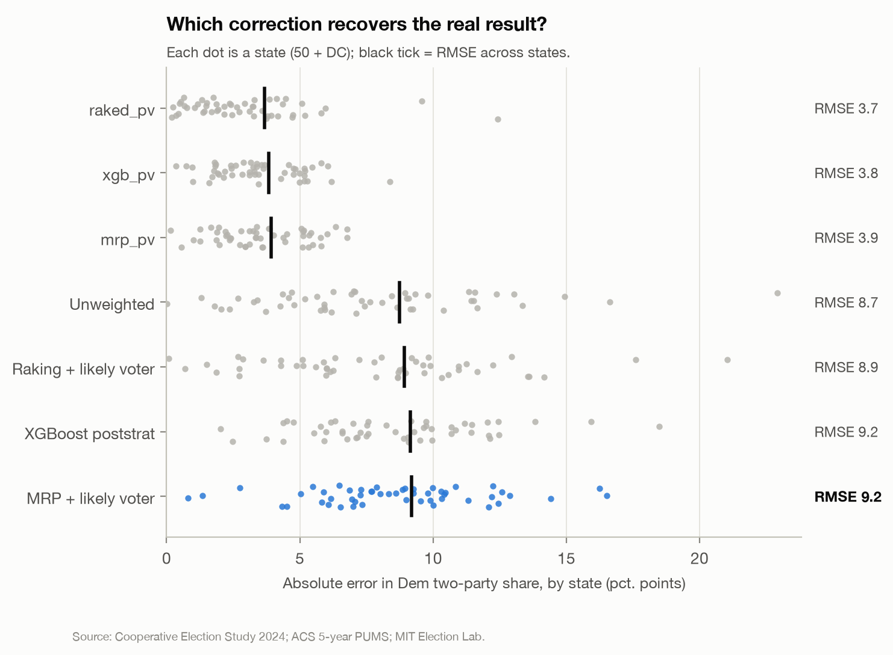
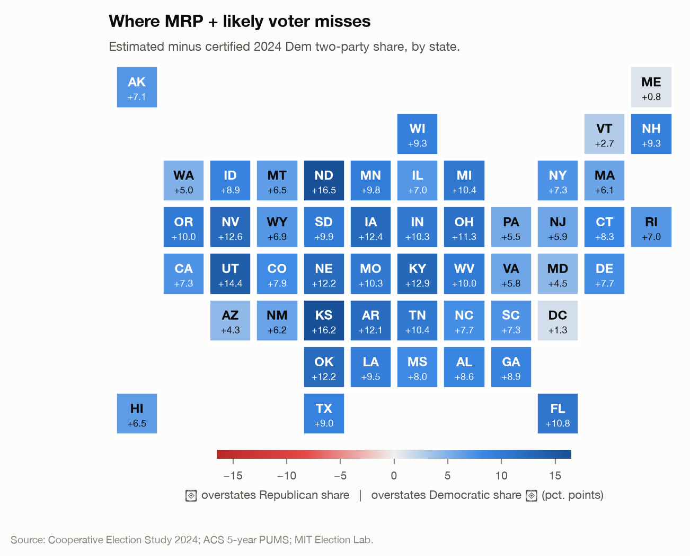

# Who Answers, Who Votes

**Correcting survey bias in the 2024 U.S. presidential election with raking, MRP, and machine learning.**


Polls ask people whether they voted, and a lot of people who didn't say they did.
This project measures that gap in the 2024 Cooperative Election Study (CES) using
voter-file validation, models who actually turns out, and then tests five ways of
correcting a survey against the one benchmark pollsters rarely get: **the certified
result in every state**.

## Key results

<!-- RESULTS:START -->
- **Turnout is overstated by 3.0 to 22.4 points.** 93% of respondents (unweighted) say they voted, versus 71% with a validated vote when unmatched respondents count as non-voters; restricting to respondents matched to the voter file narrows the gap to 3.0 points. Both are significant (McNemar p < .001).
- **Overreporting is patterned, not random.** The largest effect is Party ID (7-pt): not sure  (vs strong Democrat): -30.9 pts in the probability of claiming a vote, among respondents confirmed in the voter file as non-voters.
- **Gradient boosting predicts turnout better than logistic regression** with demographics alone (AUC 0.788 vs 0.784; 95% CI for the difference [+0.003, +0.006]).
- **Demographic adjustment cannot fix partisan non-response; recalled 2020 vote largely can.** Without 2020 vote, estimates overstate the Democratic share by 7.6–8.6 points on average across states; adding it cuts this to 2.4–3.4 points (average bias 63% lower).
- **raked_pv recovers state results best**: RMSE 3.7 pts vs 9.2 for MRP + likely voter. Its RMSE is lower than every alternative (all bootstrap CIs exclude zero).

<p align="center"> </p>

Full write-up: [`reports/REPORT.md`](reports/REPORT.md)
<!-- RESULTS:END -->

---

## What this project demonstrates

| Area | Where |
|---|---|
| **SQL data modeling**: raw → clean → mart layers, harmonizing two surveys onto one cell definition | [`sql/`](sql) |
| **Survey methodology**: vote validation, raking with weight trimming, design effects, poststratification | [`overreport.py`](src/wawv/overreport.py), [`estimators.py`](src/wawv/estimators.py) |
| **Statistical inference**: McNemar, logistic regression with marginal effects, Wilcoxon signed-rank, bootstrap CIs | [`overreport.py`](src/wawv/overreport.py), [`evaluate.py`](src/wawv/evaluate.py) |
| **Machine learning**: scikit-learn pipelines, XGBoost, calibration, permutation importance | [`turnout_ml.py`](src/wawv/turnout_ml.py) |
| **Bayesian modeling**: multilevel regression and poststratification in bambi/PyMC, with convergence diagnostics | [`estimators.py`](src/wawv/estimators.py), [`notebooks/`](notebooks) |
| **Communication**: auto-generated report, consistent figure system, interactive dashboard | [`reports/`](reports), [`app/`](app) |
| **Engineering**: reproducible `make` pipeline, synthetic-data test harness, unit tests, CI | [`Makefile`](Makefile), [`tests/`](tests), [`.github/`](.github/workflows) |

## Research questions

| # | Question | Method |
|---|---|---|
| RQ1 | How much do respondents overstate turnout? | McNemar's test, self-report vs validated record |
| RQ2 | Who overreports? | Logistic regression, average marginal effects |
| RQ3 | Can we predict who actually votes? | Logistic vs XGBoost: AUC, Brier, calibration, bootstrap AUC difference |
| RQ4 | Which correction best recovers each state's result? | 5 estimators vs certified 2024 results: RMSE, Wilcoxon signed-rank, bootstrap CIs |

The five estimators in RQ4:

| Estimator | Description |
|---|---|
| Unweighted | Raw mean among self-reported voters |
| CES weight | The study's own post-election weight |
| Raking + likely voter | Raked within state to ACS adult-citizen margins × predicted turnout |
| XGBoost poststrat | XGBoost vote model over population cells, weighted by cell size × predicted turnout |
| MRP + likely voter | Bayesian multilevel model over population cells, weighted by cell size × predicted turnout |

## Pipeline

```mermaid
flowchart LR
    A[CES 2024<br/>.dta] --> R[(DuckDB<br/>raw)]
    B[ACS PUMS<br/>.csv] --> R
    C[MIT Election Lab<br/>.csv] --> R
    R --> CL[(clean.ces)]
    R --> M[(mart.poststrat<br/>mart.truth)]
    CL --> Q12[RQ1–2<br/>overreporting]
    CL --> Q3[RQ3<br/>turnout ML]
    Q3 -- p&#40;vote&#41; --> Q4[RQ4<br/>5 estimators]
    M --> Q4
    Q4 --> E[evaluate]
    Q12 & Q3 & E --> OUT[figures · REPORT.md · dashboard]
```



## Quick start

```bash
git clone https://github.com/YOUR-USERNAME/who-answers-who-votes.git
cd who-answers-who-votes
python -m venv .venv && source .venv/bin/activate
make install

make demo             # whole pipeline on synthetic data, ~3 min, no downloads
make dashboard-demo   # explore the demo results in the browser
```

Then, with the real data in place (below):

```bash
make all              # load → RQ1–4 → figures → reports/REPORT.md (+ README results)
make dashboard
```

Run `make help` to list every step.

## Data

Download into `data/raw/` (not redistributed in this repo):

| File | Source |
|---|---|
| `CES24_Common.dta` | [Cooperative Election Study](https://cces.gov.harvard.edu/), 2024 Common Content (Harvard Dataverse) |
| `pums/psam_pus*.csv` | ACS 5-year PUMS person files, all states (census.gov → ACS → Microdata) |
| `1976-2024-president.csv` | MIT Election Data + Science Lab, U.S. President 1976–2024 (Harvard Dataverse) |

Variable definitions and every output table are documented in
[`docs/data_dictionary.md`](docs/data_dictionary.md).

> **Before the first real run:** confirm the CES variable names and response codes in
> [`src/wawv/config.py`](src/wawv/config.py) and [`sql/02_clean_ces.sql`](sql/02_clean_ces.sql)
> against the 2024 codebook (marked `TODO`). The loader stops with a clear error if a
> column is missing.

## Repository layout

```
├── sql/                    # DuckDB data modeling (raw → clean → mart)
├── src/wawv/
│   ├── load.py             # ingest raw files, run SQL
│   ├── overreport.py       # RQ1–2
│   ├── turnout_ml.py       # RQ3
│   ├── estimators.py       # RQ4: raking, MRP, XGBoost poststratification
│   ├── evaluate.py         # RQ4: accuracy + paired tests
│   ├── figures.py, viz.py  # figure set + shared style
│   ├── report.py           # writes REPORT.md and the README results block
│   └── synth.py            # synthetic data with the real files' layout
├── app/dashboard.py        # Streamlit explorer
├── notebooks/              # MRP convergence diagnostics
├── reports/                # committed figures, tables, REPORT.md
├── docs/data_dictionary.md
└── tests/
```

## Limitations

Vote validation misses some real voters, the ACS records only binary sex, vote choice
comes from self-reported voters, and the population frame uses five variables. The
generated `REPORT.md` discusses each one.

## Author

**Conall Noonan**, Sociology & Data Science, University of Washington
