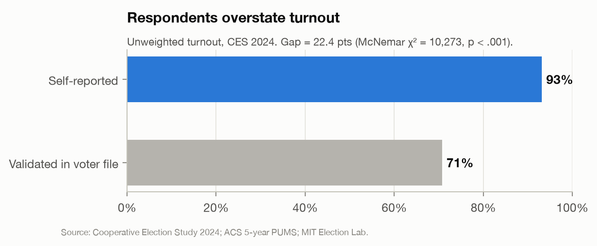
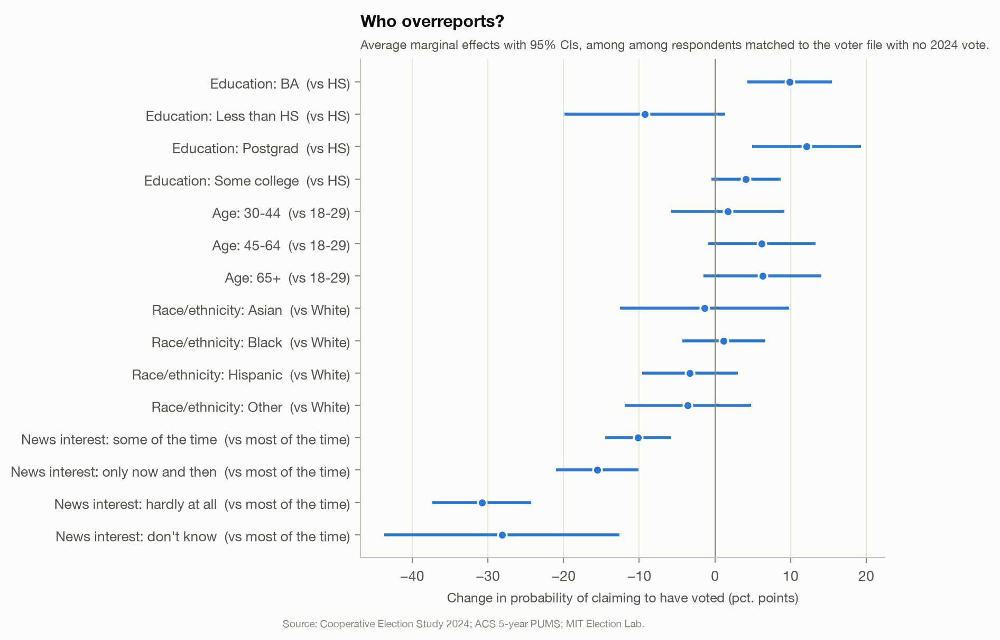
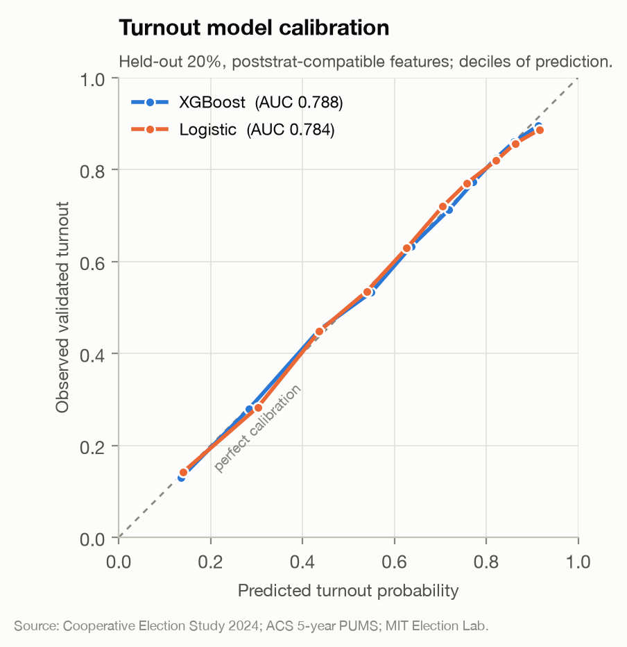
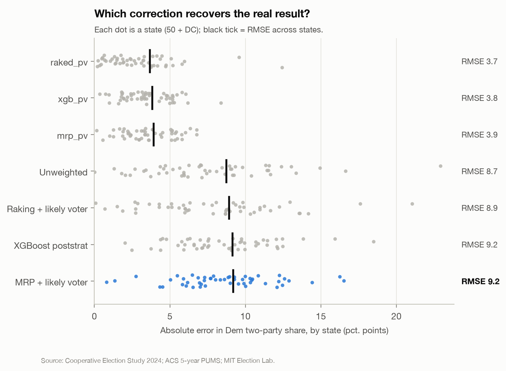
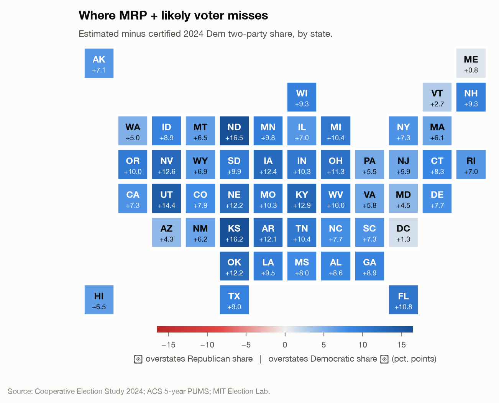
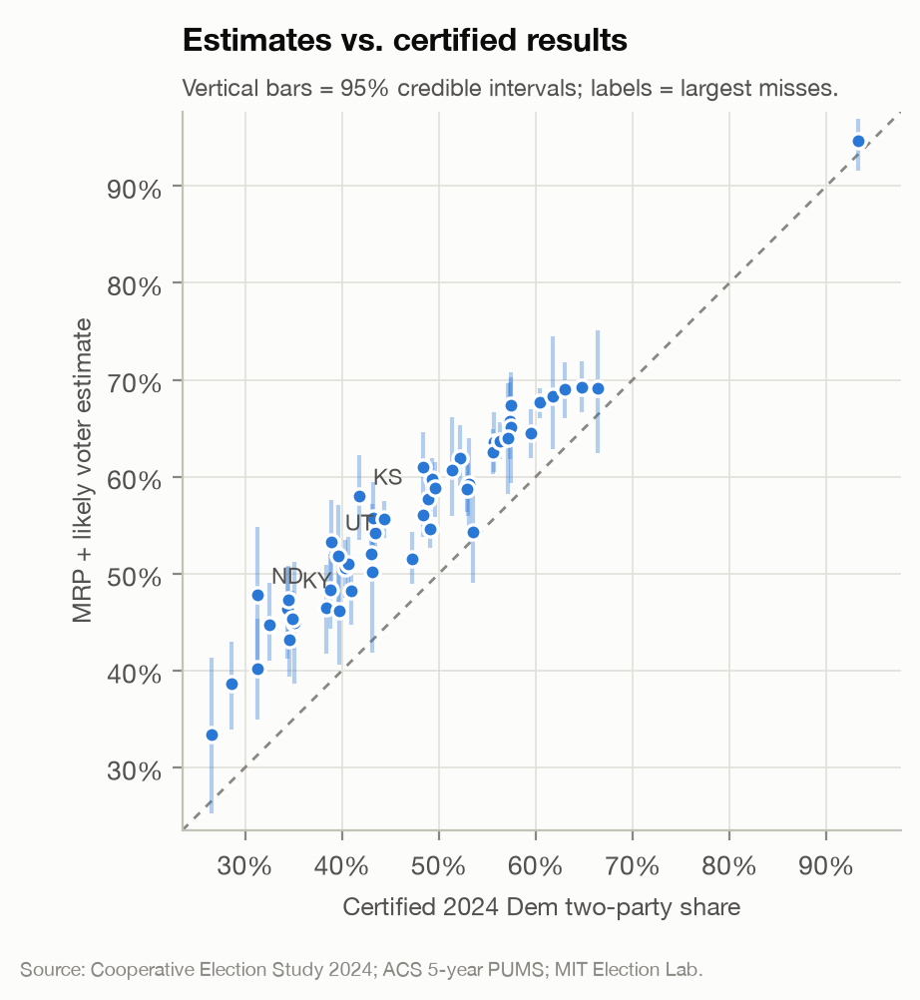

# Who Answers, Who Votes
### Correcting survey bias in the 2024 U.S. presidential election

_Generated November 14, 2026 by `wawv.report`._

## Summary

1. **Turnout is overstated by 3.0 to 22.4 points.** 93% of respondents (unweighted) say they voted, versus 71% with a validated vote when unmatched respondents count as non-voters; restricting to respondents matched to the voter file narrows the gap to 3.0 points. Both are significant (McNemar p < .001).
2. **Overreporting is patterned, not random.** The largest effect is Party ID (7-pt): not sure  (vs strong Democrat): -30.9 pts in the probability of claiming a vote, among respondents confirmed in the voter file as non-voters.
3. **Gradient boosting predicts turnout better than logistic regression** with demographics alone (AUC 0.788 vs 0.784; 95% CI for the difference [+0.003, +0.006]).
4. **Demographic adjustment cannot fix partisan non-response; recalled 2020 vote largely can.** Without 2020 vote, estimates overstate the Democratic share by 7.6–8.6 points on average across states; adding it cuts this to 2.4–3.4 points (average bias 63% lower).
5. **raked_pv recovers state results best**: RMSE 3.7 pts vs 9.2 for MRP + likely voter. Its RMSE is lower than every alternative (all bootstrap CIs exclude zero).

## 1. Data

| Source | Use |
|---|---|
| Cooperative Election Study (CES) 2024 Common Content | Respondent demographics, self-reported turnout and vote choice, TargetSmart-validated turnout |
| American Community Survey 5-year PUMS | Poststratification frame: adult citizens by state × age × sex × race/ethnicity × education |
| MIT Election Data + Science Lab | Certified 2024 state results (ground truth); 2020 results as a state-level predictor and as recalled-vote targets; 2024 total votes cast for turnout calibration |

All three are loaded into a single DuckDB database (`sql/`): raw → clean (CES recoded
to the ACS cell definitions) → mart (poststratification frame, raking margins, truth and
vote-total tables). Validated turnout follows the CES guide's Specification 1: TS_g2024
codes 1–6 are voters; code 7 (matched non-voters) and unmatched respondents are non-voters.

The CES's own weights are not used. They are post-stratified on 2024 presidential vote by
state (CES 2024 Guide, p. 17), so they are calibrated to the outcome being estimated and
cannot fairly measure misreporting or compete as an estimator.

## 2. Methods

**RQ1 – Overreporting.** McNemar's test compares each respondent's self-reported
turnout with their validated record, among respondents who answered the turnout question
(unweighted). Because unmatched respondents may be real voters the vendor could not find,
the gap is reported as a range: an upper bound counting unmatched respondents as
non-voters, and a lower bound restricted to respondents matched to the voter file.

**RQ2 – Who overreports.** Logistic regression of claiming to have voted, among
respondents with no validated vote, on education, age, race/ethnicity, party ID and
news interest; average marginal effects with 95% CIs. Re-estimated among matched
non-voters only, to separate misreporting from voter-file matching failure.

**RQ3 – Turnout prediction.** Logistic regression and XGBoost on a stratified 80/20
split, with two feature sets: demographics only (the set that also exists in the ACS,
so it can be poststratified) and demographics + attitudes. Evaluated by AUC, Brier
score and calibration; AUC difference by bootstrap.

**RQ4 – Recovering the election result.** Seven estimators of each state's
Democratic share of the two-party vote, in two families. Turnout models are calibrated
so predicted voters match each state's certified 2024 total votes cast (turnout level
only, never the partisan split).

| Estimator | How |
|---|---|
| Unweighted | Mean among self-reported voters |
| Raking + likely voter | Within-state raking to ACS margins (weights capped at 5× mean), × predicted turnout |
| XGBoost poststrat | XGBoost vote-choice model on frame cells, weighted by cell N × predicted turnout |
| MRP + likely voter | Bayesian multilevel binomial model (bambi/PyMC) with state, age, race, education, race×education and age×education effects, sex and 2020 state vote as fixed effects; poststratified by cell N × predicted turnout |
| Raking + 2020 vote | Within-state raking to ACS margins and to certified 2020 vote shares (Biden / Trump / other / did not vote, as shares of today's adult citizens), × 2020-vote-aware turnout |
| XGBoost + 2020 vote | XGBoost vote model with recalled 2020 vote, poststratified over a frame expanded by 2020 vote group and calibrated (IPF) to each state's 2020 result |
| MRP + 2020 vote | The MRP model plus a 2020-vote fixed effect, poststratified over the same calibrated frame |

Accuracy is RMSE, MAE and bias against certified results. Methods are compared with
Wilcoxon signed-rank tests on paired absolute state errors and bootstrap CIs for RMSE
differences.

## 3. Results

### Turnout is overstated





### Predicting who votes

**Table 1. Turnout models, held-out test set**

| Features | Model | AUC | Brier |
|---|---|---|---|
| Demographics only | Logistic | 0.784 | 0.180 |
| Demographics only | XGBoost | 0.788 | 0.178 |
| + partisanship, ideology, news interest | Logistic | 0.806 | 0.170 |
| + partisanship, ideology, news interest | XGBoost | 0.812 | 0.168 |



Most important features in the full model (permutation importance, AUC drop):
`age_grp` (0.082), `educ` (0.069), `newsint` (0.033), `race` (0.023), `state_fips` (0.009).

### Recovering the 2024 result

**Table 2. Accuracy against certified 2024 results** (percentage points)

| Method | Bias (pts) | MAE (pts) | RMSE (pts) | States |
|---|---|---|---|---|
| raked_pv | +2.38 | 2.91 | 3.68 | 51 |
| xgb_pv | +3.23 | 3.46 | 3.83 | 51 |
| mrp_pv | +3.38 | 3.57 | 3.93 | 51 |
| Unweighted | +7.60 | 7.68 | 8.75 | 51 |
| Raking + likely voter | +7.83 | 7.89 | 8.93 | 51 |
| XGBoost poststrat | +8.47 | 8.57 | 9.16 | 51 |
| MRP + likely voter | +8.61 | 8.61 | 9.20 | 51 |

**Table 3. Paired comparisons with the best method**

| Method | Compared with | Wilcoxon p | RMSE difference, 95% CI (pts) |
|---|---|---|---|
| mrp_pv | MRP + likely voter | p < .001 | [-6.04, -4.56] |
| Raking + likely voter | MRP + likely voter | p = 0.014 | [-0.82, +0.31] |
| raked_pv | MRP + likely voter | p < .001 | [-6.43, -4.58] |
| Unweighted | MRP + likely voter | p < .001 | [-1.07, +0.29] |
| XGBoost poststrat | MRP + likely voter | p = 0.399 | [-0.26, +0.19] |
| xgb_pv | MRP + likely voter | p < .001 | [-6.05, -4.71] |







**MRP convergence.**
- MRP + likely voter: Max R̂ = 1.002 (target < 1.01) · min bulk ESS = 2352 (target > 400) · divergences = 0 (target 0) across 119 parameters. All convergence checks pass.
- MRP + 2020 vote: Max R̂ = 1.003 (target < 1.01) · min bulk ESS = 1386 (target > 400) · divergences = 0 (target 0) across 122 parameters. All convergence checks pass.

**Raking weights (Kish design effect across states).** Demographic raking median 1.10 (range 1.05–1.27); raking with 2020 vote median 1.13 (range 1.07–1.48).

## 4. Limitations

- **Vote validation is imperfect.** Unmatched respondents include real voters the
  vendor could not find, which is why RQ1 is reported as a range. The turnout model and
  likely-voter adjustment use the broader definition, so they partly learn who is hard
  to match (e.g. young, mobile respondents).
- **Recalled 2020 vote is itself reported.** Some 2020 non-voters claim to have voted and
  some recall their choice inaccurately; any such error limits the correction.
- **Residual bias remains.** Even with 2020 vote, estimates lean Democratic by a few
  points, consistent with non-response *within* 2020 vote groups (e.g. Biden 2020 voters
  who moved to Trump being less likely to respond); this is a hypothesis, not tested here.
- **Binary sex in the ACS.** Nonbinary and other-gender CES respondents can't be
  placed in a frame cell and are excluded from the poststratified models.
- **Vote choice comes from self-reported voters**, including some who didn't vote.
- **The 2020-vote frame is modelled.** The joint distribution of demographics and
  2020 vote comes from a model of the CES calibrated to state totals, not from a census.
- **Truth is partly used.** Turnout is calibrated to certified 2024 vote totals (level
  only, never the partisan split), and this is a retrospective benchmark; a forecasting
  setting would have neither.

## 5. Reproduce

```bash
pip install -r requirements.txt
make all        # load → overreport → turnout → estimate → evaluate → figures → report
# add or refit only the 2020-vote methods:
PYTHONPATH=src python -m wawv.estimators --pv-only --draws 2000 --chains 4
```
