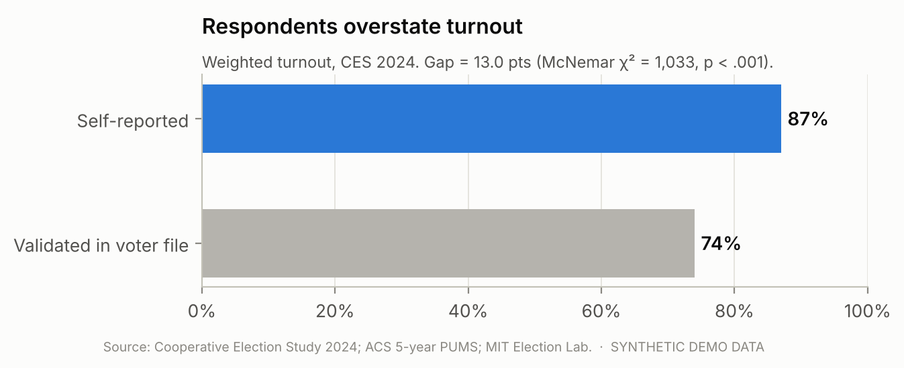
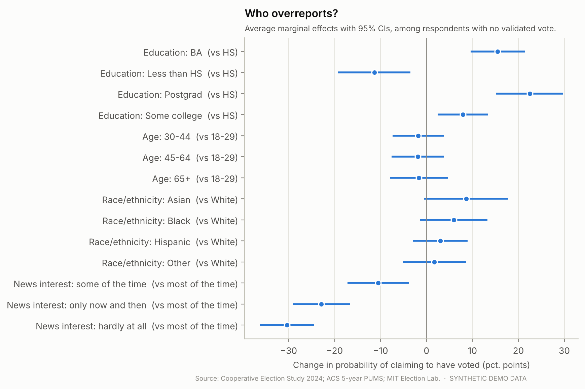
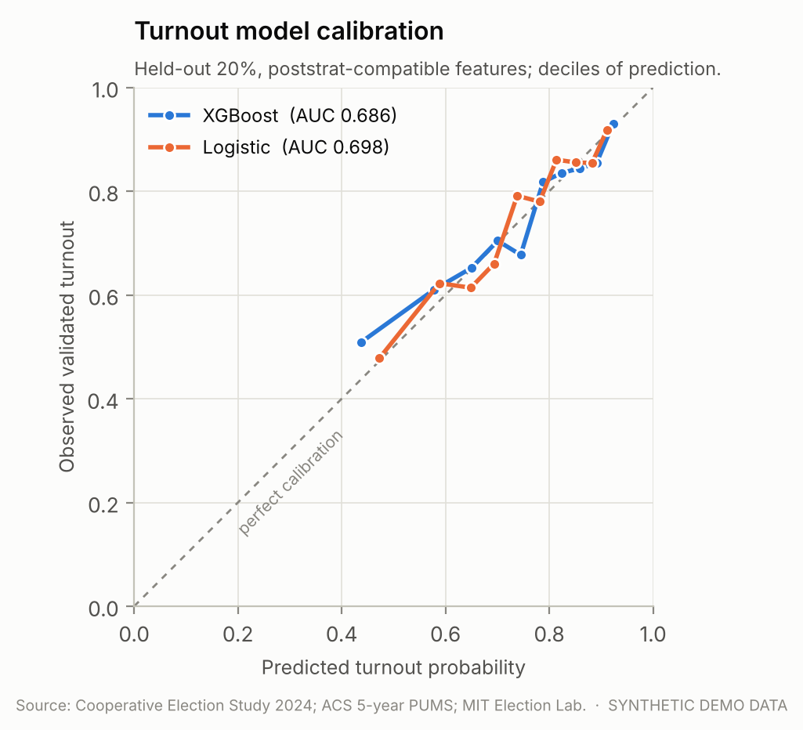
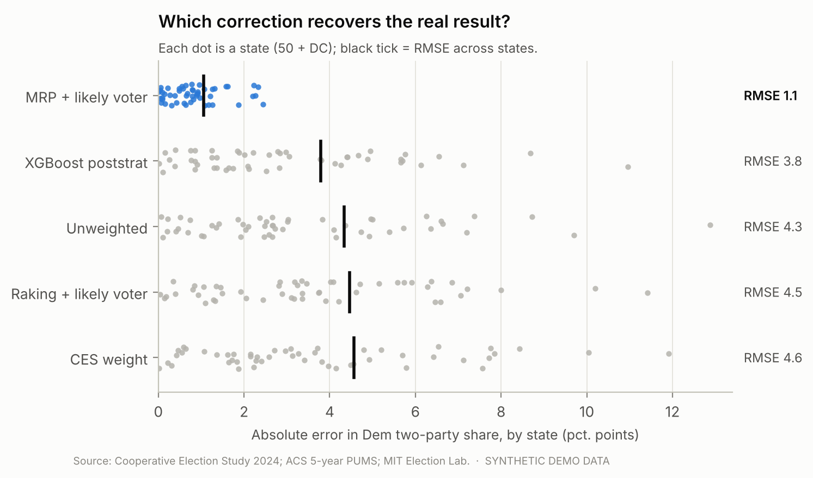
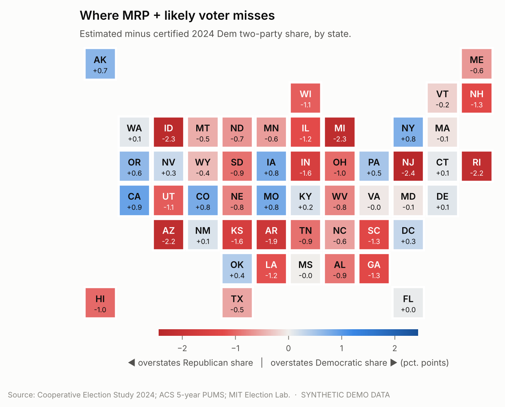
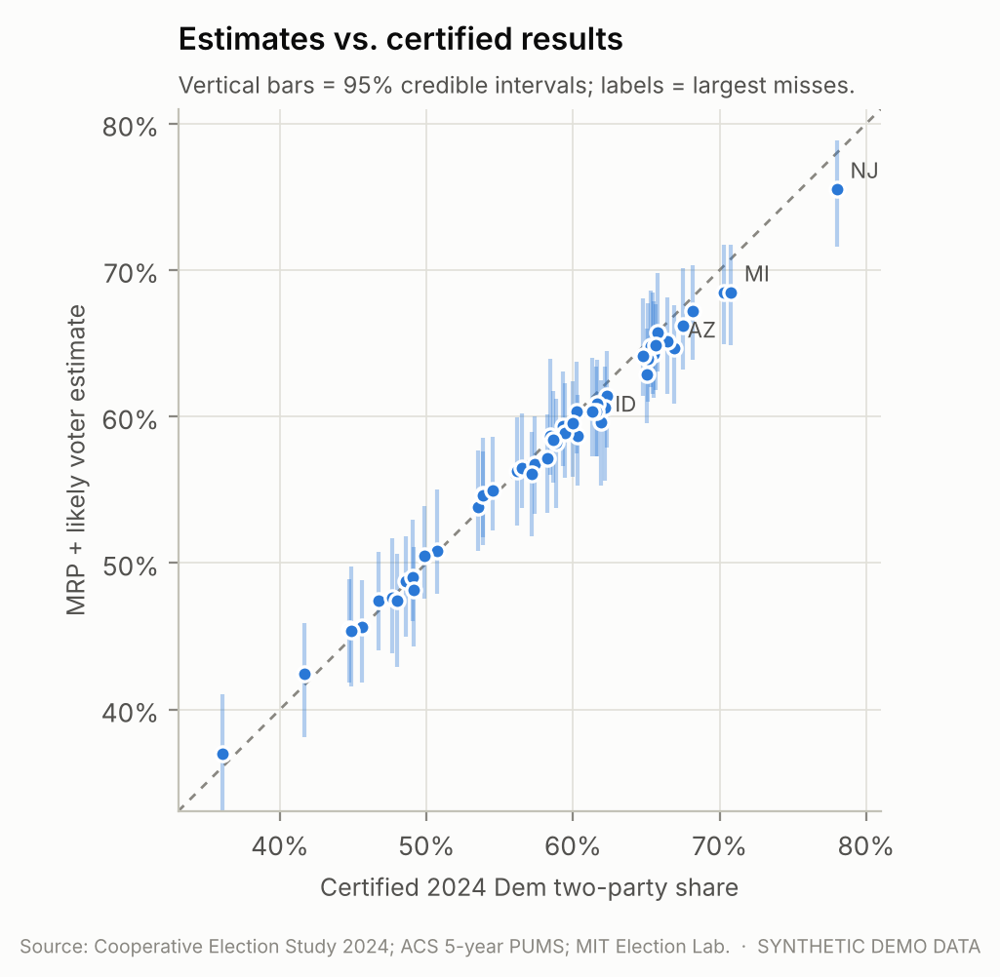

# Who Answers, Who Votes
### Correcting survey bias in the 2024 U.S. presidential election

> ⚠️ **These results come from synthetic demo data** generated by `wawv.synth`. They show the pipeline works; they are not findings.

_Generated November 11, 2026 by `wawv.report`._

## Summary

1. **Turnout is overstated by 13.0 points.** 87% of respondents (weighted) say they voted; 74% have a voter-file record (McNemar χ² = 1,033, p < .001).
2. **Overreporting is patterned, not random.** The largest effect is News interest: hardly at all  (vs most of the time): -30.4 pts in the probability of claiming a vote, among validated non-voters.
3. **Gradient boosting doesn't beat logistic regression on turnout** with demographics alone (AUC 0.686 vs 0.698; 95% CI for the difference [-0.024, +0.000]).
4. **MRP + likely voter recovers state results best**: RMSE 1.1 pts vs 4.6 for CES weight. It beats every alternative in paired tests across states (largest Wilcoxon p < .001).

## 1. Data

| Source | Use |
|---|---|
| Cooperative Election Study (CES) 2024 Common Content | Respondent demographics, self-reported turnout and vote choice, TargetSmart-validated turnout |
| American Community Survey 5-year PUMS | Poststratification frame: adult citizens by state × age × sex × race/ethnicity × education |
| MIT Election Data + Science Lab | Certified 2024 state results (ground truth); 2020 results as a state-level predictor |

All three are loaded into a single DuckDB database (`sql/`): raw → clean (CES recoded
to the ACS cell definitions) → mart (poststratification frame, raking margins, truth table).

## 2. Methods

**RQ1 – Overreporting.** McNemar's test compares each respondent's self-reported
turnout with their validated record.

**RQ2 – Who overreports.** Logistic regression of claiming to have voted, among
respondents with no validated vote, on education, age, race/ethnicity, party ID and
news interest; average marginal effects with 95% CIs.

**RQ3 – Turnout prediction.** Logistic regression and XGBoost on a stratified 80/20
split, with two feature sets: demographics only (the set that also exists in the ACS,
so it can be poststratified) and demographics + attitudes. Evaluated by AUC, Brier
score and calibration; AUC difference by bootstrap.

**RQ4 – Recovering the election result.** Five estimators of each state's
Democratic share of the two-party vote:

| Estimator | How |
|---|---|
| Unweighted | Mean among self-reported voters |
| CES weight | CES post-election weight |
| Raking + likely voter | Within-state raking to ACS margins (weights capped at 5× mean), × predicted turnout |
| XGBoost poststrat | XGBoost vote-choice model on frame cells, weighted by cell N × predicted turnout |
| MRP + likely voter | Bayesian multilevel binomial model (bambi/PyMC) with state, age, sex, race, education and race×education, age×education effects plus 2020 state vote; poststratified by cell N × predicted turnout |

Accuracy is RMSE, MAE and bias against certified results. Methods are compared with
Wilcoxon signed-rank tests on paired absolute state errors and bootstrap CIs for RMSE
differences.

## 3. Results

### Turnout is overstated





### Predicting who votes

**Table 1. Turnout models, held-out test set**

| Features | Model | AUC | Brier |
|---|---|---|---|
| Demographics only | Logistic | 0.698 | 0.173 |
| Demographics only | XGBoost | 0.686 | 0.176 |
| + partisanship, ideology, news interest | Logistic | 0.710 | 0.171 |
| + partisanship, ideology, news interest | XGBoost | 0.696 | 0.174 |



Most important features in the full model (permutation importance, AUC drop):
`age_grp` (0.137), `educ` (0.041), `newsint` (0.024), `state_fips` (0.003), `race` (0.001).

### Recovering the 2024 result

**Table 2. Accuracy against certified 2024 results** (percentage points)

| Method | Bias (pts) | MAE (pts) | RMSE (pts) | States |
|---|---|---|---|---|
| MRP + likely voter | -0.55 | 0.84 | 1.06 | 51 |
| XGBoost poststrat | -0.47 | 2.96 | 3.78 | 51 |
| Unweighted | +1.29 | 3.39 | 4.33 | 51 |
| Raking + likely voter | -0.37 | 3.64 | 4.46 | 51 |
| CES weight | +1.19 | 3.66 | 4.56 | 51 |

**Table 3. Paired comparisons with the best method**

| Method | Compared with | Wilcoxon p | RMSE difference, 95% CI (pts) |
|---|---|---|---|
| CES weight | MRP + likely voter | p < .001 | [+2.60, +4.38] |
| Raking + likely voter | MRP + likely voter | p < .001 | [+2.69, +4.17] |
| Unweighted | MRP + likely voter | p < .001 | [+2.31, +4.26] |
| XGBoost poststrat | MRP + likely voter | p < .001 | [+1.98, +3.51] |







**MRP convergence.** Max R̂ = 1.011 (target < 1.01) · min bulk ESS = 283 (target > 400) · divergences = 4 (target 0) across 121 parameters. ⚠️ At least one check fails: run longer chains (`make estimate DRAWS=2000`) before reporting MRP results.

**Raking weights.** Median Kish design effect across states = 1.14
(range 1.04–1.47).

## 4. Limitations

- **Vote validation is imperfect.** Some apparent overreporters are respondents the
  vendor failed to match to the voter file, so RQ1 is an upper bound on misreporting.
- **Binary sex in the ACS.** Nonbinary and other-gender CES respondents can't be
  placed in a frame cell and are excluded from the poststratified models.
- **Vote choice comes from self-reported voters**, including some who didn't vote.
- **A five-variable frame.** Income, urbanicity or past vote would need a richer
  frame (e.g. a raked or synthetic joint distribution).
- **Truth is known in advance.** This is a retrospective benchmark; a forecasting
  setting would have no certified results to tune against.

## 5. Reproduce

```bash
pip install -r requirements.txt
make all        # load → overreport → turnout → estimate → evaluate → figures → report
```
